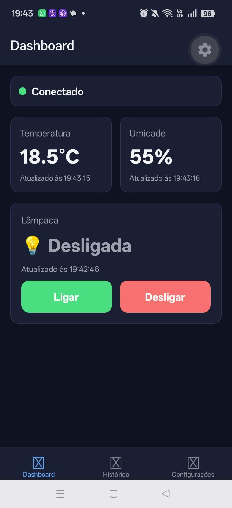
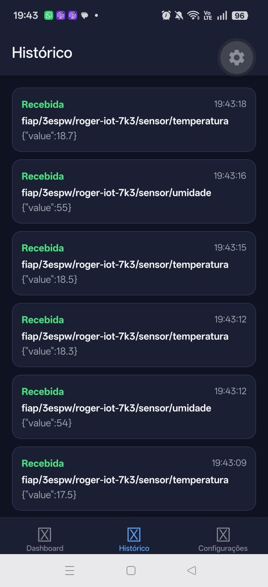
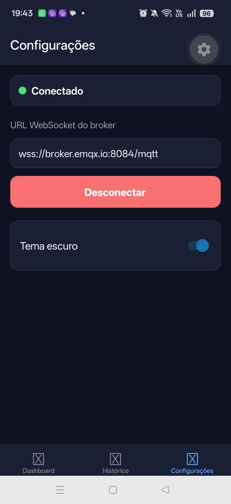

# IoT Control — Painel de Monitoramento e Controle IoT com MQTT

Checkpoint 3 — Mobile Development & IoT (FIAP)

## Autor

| Nome completo | RM |
|---|---|
| Roger Cardoso Ferreira | RM557230 |

## Descrição e objetivo

O **IoT Control** é um aplicativo mobile em React Native que monitora e controla um ambiente inteligente simulado usando o protocolo **MQTT** (modelo publish/subscribe) sobre **WebSocket**.

O usuário visualiza em tempo real as leituras de **temperatura** e **umidade**, controla uma **lâmpada virtual** (Ligar/Desligar), consulta o **histórico das 10 últimas mensagens** e configura o endereço do broker e o tema (Light/Dark). Não há hardware físico: um script Node.js simula o dispositivo.

## Tecnologias e versões

- React Native com Expo (`expo ~58.01.19`) e TypeScript
- MQTT.js (`mqtt`) como cliente MQTT
- `@react-native-async-storage/async-storage` para preferências locais
- React Navigation (`@react-navigation/native` e `@react-navigation/bottom-tabs`)
- Node.js para o simulador (`simulator/`)

> As versões exatas de cada dependência estão no `package.json` do projeto e do simulador.

## Passo a passo de instalação e execução

### Pré-requisitos

- Node.js instalado
- App **Expo Go** no celular (Android ou iOS), com celular e computador na **mesma rede Wi-Fi**

### 1. Rodar o aplicativo

```bash
git clone https://github.com/rogercf17/Checkpoint6_MobileDevlopment.git
cd Checkpoint6_MobileDevelopment
npm install
npx expo start
```

Escaneie o QR code com o Expo Go (no iPhone, use a câmera). Se a rede bloquear a conexão, use `npx expo start --tunnel`.

### 2. Rodar o simulador do dispositivo

Em outro terminal:

```bash
cd simulator
npm install
npm start
```

## Broker e URL WebSocket de teste

- **URL WebSocket usada (padrão):** `wss://broker.emqx.io:8084/mqtt`
  - Host: `broker.emqx.io` | Porta WebSocket seguro: `8084` | Caminho: `/mqtt`
- Alternativa: `wss://broker.hivemq.com:8884/mqtt`
- A URL pode ser alterada na tela **Configurações** e fica salva no AsyncStorage.

> A porta **1883** é MQTT sobre TCP e **não** funciona no aplicativo. Para o app é necessário uma porta **WebSocket (WS/WSS)**.

Nenhuma senha, token ou credencial é usada ou armazenada neste repositório.

## Tópicos MQTT

Prefixo exclusivo do projeto: `fiap/3espw/roger-iot-7k3`

| Tópico | Direção no app | Payload de exemplo |
|---|---|---|
| `fiap/3espw/roger-iot-7k3/sensor/temperatura` | Subscribe | `{"value":24.5}` |
| `fiap/3espw/roger-iot-7k3/sensor/umidade` | Subscribe | `{"value":58}` |
| `fiap/3espw/roger-iot-7k3/lampada/comando` | Publish | `{"action":"ON"}` ou `{"action":"OFF"}` |
| `fiap/3espw/roger-iot-7k3/lampada/estado` | Subscribe | `{"state":"ON"}` ou `{"state":"OFF"}` |

O prefixo está definido em `src/config/mqtt.ts` (app) e em `simulator/device.js` (simulador); os dois devem ser iguais. O estado da lâmpada exibido no app reflete **somente a mensagem recebida em `lampada/estado`**, não o toque no botão.

## Como executar e reproduzir o simulador

### Opção 1 — Script incluído no repositório (recomendada)

```bash
cd simulator
npm install
npm start
```

O script:

- publica temperatura (a cada 3 s) e umidade (a cada 4 s);
- escuta `lampada/comando`;
- ao receber `ON` ou `OFF`, publica o novo estado em `lampada/estado`.

Para usar outro broker ou prefixo, defina as variáveis de ambiente `BROKER_URL` e `TOPIC_BASE` antes de executar.

### Opção 2 — Cliente MQTTX (manual)

1. Baixe o MQTTX (desktop) em https://mqttx.app.
2. Crie uma conexão: host `broker.emqx.io`, porta `8084`, caminho `/mqtt`, protocolo `wss`.
3. Inscreva-se em `fiap/3espw/roger-iot-7k3/#`.
4. Publique `{"value":24.5}` em `.../sensor/temperatura` e `{"value":58}` em `.../sensor/umidade`.
5. Ao tocar em Ligar/Desligar no app, o comando chega em `.../lampada/comando`; publique `{"state":"ON"}` (ou `OFF`) em `.../lampada/estado` para confirmar.

### Roteiro de verificação do ciclo completo

1. O simulador publica uma temperatura e a tela atualiza.
2. O simulador publica uma umidade e a tela atualiza.
3. O usuário toca em **Ligar** no app.
4. O simulador recebe o comando e publica o novo estado.
5. O app recebe o estado e mostra **Ligada**.
6. O mesmo fluxo funciona com **Desligar**.

## Telas e funcionalidades

> Prints das telas na pasta `docs/prints/`.

### Dashboard



- Status da conexão (conectando, conectado, desconectado ou erro) e botão **Reconectar** quando necessário.
- Cards de temperatura e umidade com o último valor e o horário da atualização.
- Estado da lâmpada com horário e botões **Ligar** e **Desligar**.
- Sem conexão, o app exibe um alerta e não publica o comando silenciosamente.
- Enquanto aguarda a confirmação do dispositivo, mostra "aguardando confirmação".

### Histórico



- As 10 mensagens mais recentes, enviadas ou recebidas, com tópico, conteúdo, horário e direção.
- Atualizado automaticamente enquanto o app está aberto.

### Configurações



- Campo para a URL WebSocket do broker, com validação do formato `ws://` ou `wss://`.
- Botões Conectar/Desconectar e Reconectar com a nova URL.
- Alternância de tema Light/Dark.
- URL do broker e tema salvos com AsyncStorage e recuperados ao reiniciar o app.

## Organização do código

```text
src/
  components/    ConnectionStatus, SensorCard, MessageItem
  config/        mqtt.ts (URL padrão e tópicos)
  context/       MqttContext.tsx (estado global)
  screens/       DashboardScreen, HistoryScreen, SettingsScreen
  services/      mqttService.ts, storageService.ts
  themes/        colors.ts
  types/         mqtt.ts
simulator/       device.js (simulador do dispositivo)
```

- A comunicação MQTT fica isolada em `mqttService.ts`, separada da interface.
- As mensagens recebidas são validadas (JSON e tipos) antes de atualizar a tela; payloads inválidos são ignorados no cartão, mas aparecem no histórico.
- Listeners e inscrições são removidos no cleanup dos `useEffect`, evitando eventos duplicados.
- Reconexão automática a cada 3 segundos, além da ação manual de reconectar.

## Limitações e observações

- O broker utilizado é **público e sem autenticação**: qualquer pessoa que conheça o prefixo dos tópicos pode ler e publicar mensagens. Por isso o prefixo inclui um sufixo exclusivo.
- Disponibilidade e portas dos brokers públicos podem mudar; se a URL padrão não conectar, configure outra na tela Configurações.
- As mensagens usam QoS 0 (no máximo uma vez).
- O estado da lâmpada só muda no app quando o dispositivo (simulador) confirma em `lampada/estado`.
- Testado com Expo Go. O funcionamento em Web não foi validado.
